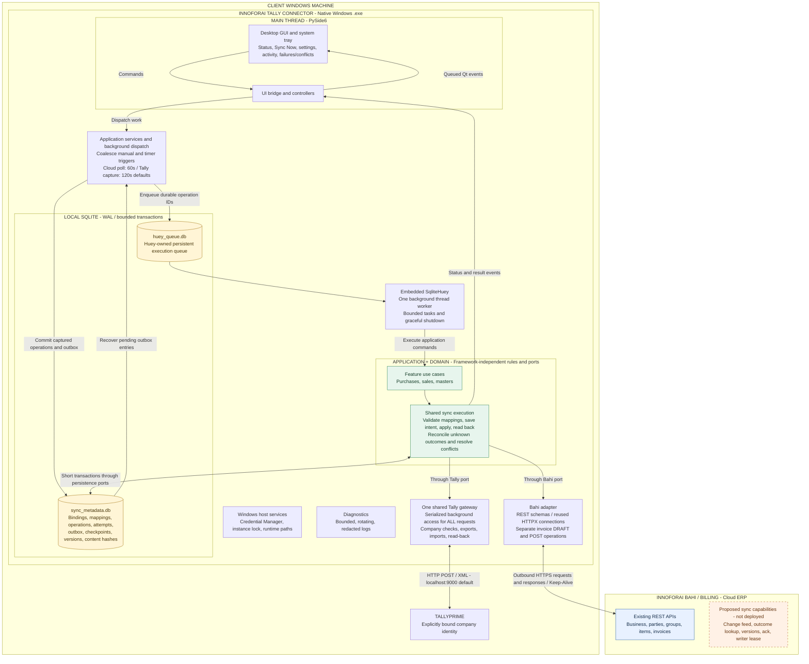

# Project architecture

This diagram shows the **target architecture** of the native Windows connector.
It is a visual guide to the [project specification](PROJECT_SPECIFICATION.md),
which owns the requirements and boundaries. Source ownership packages and Phase 0
experiments exist; the production UI, adapters and sync engine are still planned.
See [current progress](STATE_AND_PROGRESS.md) for implemented capabilities.

## System overview

The cloud connection above terminates at the Bahi adapter. Both adapters return
results through application ports; they do not call each other. The diagram
groups responsibilities rather than specifying exactly two operating-system
threads: Huey includes consumer/scheduler lifecycle work as well as its single
task worker. Use the [tested Qt/Huey embedding recipe](phase0/QT_HUEY_COMPATIBILITY.md).

## How synchronization moves through the system

1. A timer or Sync Now dispatches background work through the UI bridge and
   services. Repeated triggers are coalesced; the GUI stays responsive.
2. Capture reads the selected source through its adapter. It commits operations,
   outbox entries and the capture checkpoint together in the metadata database.
   Dispatch then queues operation IDs; startup recovery repairs missed dispatches.
3. The worker executes the relevant use case, validates the business/company
   binding and confirmed mappings, and records write intent before external IO.
4. The destination adapter applies the change. Every Tally request, including
   health and company checks, uses the same serialized gateway. HTTP calls run
   outside database transactions.
5. Identity and supported canonical content are read back before completion.
   Unknown outcomes enter reconciliation before any retry. A failed backend
   acknowledgment retries the acknowledgment without recreating the voucher.
6. Persisted results produce queued UI events for status, activity and failures.

This flow applies in both directions. Tally-to-Bahi invoice DRAFT creation and
accounting posting remain separate operations. Safe retries use a bounded policy;
authentication, missing mappings and conflicts require action.

## Storage, scheduling and backend boundaries

- Runtime data lives under `%LOCALAPPDATA%\InnoforaiTallySync\`. API secrets live
  in Windows Credential Manager; local configuration stores credential references.
  Credentials and raw business payloads are not Huey task arguments.
- The two databases have separate owners. Metadata transactions cannot atomically
  commit Huey queue changes, which is why durable outbox recovery is required.
- Polling runs only in supported modes. A 30-second option needs a separately
  tested trigger because Huey's periodic checks are minute-based.
- The supplied `/v1/sync/pending`, `/v1/sync/ack` and `/v1/sync/from-tally` routes
  are illustrative proposals, not verified deployed endpoints. The
  [backend handoff](api/bahi/SYNC_EXTENSION_CONTRACT.md) owns the proposed contracts.
- Automatic bidirectional mutation depends on verified change capture,
  idempotency/outcome lookup, version handling, origin/ack and writer ownership.
  Local serialization alone does not prevent another PC from writing.
- The connector initiates cloud requests and uses Tally's HTTP interface. It
  runs as a native desktop/tray application without a local web server.

For package-level ownership, see the
[layout and dependency rules](PROJECT_SPECIFICATION.md#dependency-and-ownership-rules).
For delivery gates, see the [implementation plan](IMPLEMENTATION_PLAN.md).
