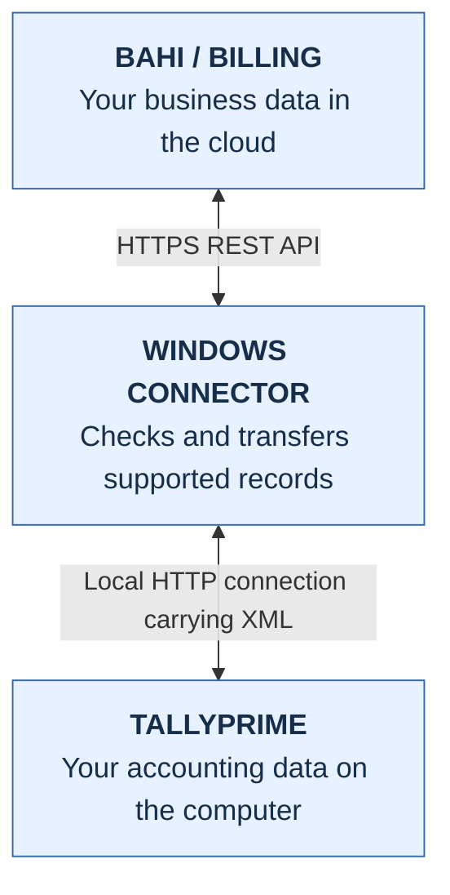
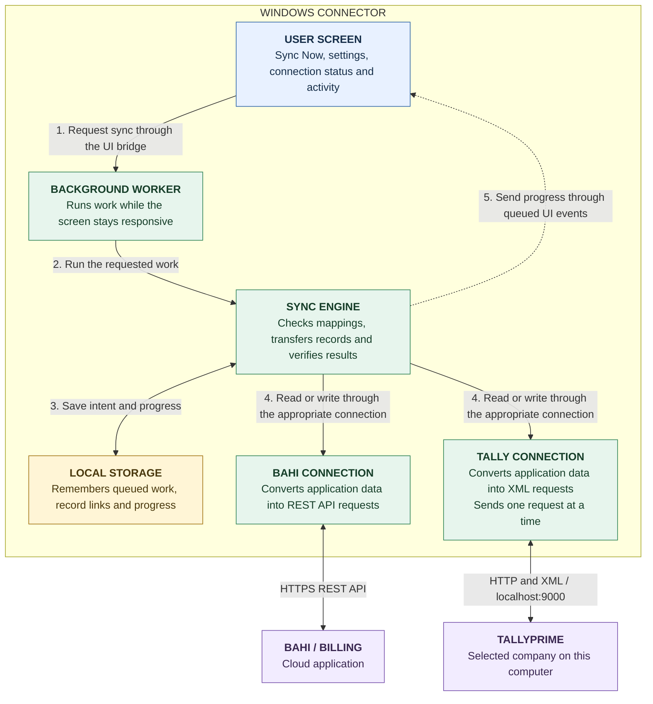

# Project architecture

The connector is a Windows application that moves supported business records
between **BAHI / BILLING** and **TALLYPRIME**. It checks records before sending
them and remembers the result so that interrupted work can be investigated safely.

These diagrams describe the **planned application**. The production UI and sync
engine are not implemented yet. See [current progress](STATE_AND_PROGRESS.md)
for what has been built and tested, and the
[project specification](PROJECT_SPECIFICATION.md) for the full requirements.

## 1. The big picture

Start here. There are three main parts:

<!-- diagram-start: architecture-overview -->

Editable Mermaid source

<!-- diagram: architecture-overview -->

[Source file](diagrams/sources/architecture-overview.mmd)

<!-- diagram-end: architecture-overview -->

Read the diagram from top to bottom. The connector talks to Bahi over the
internet and to Tally on the computer. The arrows point both ways because the
connector sends requests and receives responses; supported records can also
be transferred in either direction when the required checks are satisfied.
**The connector initiates the connections.** Bahi does not need to connect into
the user's computer.

## 2. Inside the Windows connector

This diagram shows responsibilities. Follow the numbered arrows to understand
what happens after someone clicks **SYNC NOW**.

<!-- diagram-start: connector-components -->

Editable Mermaid source

<!-- diagram: connector-components -->

[Source file](diagrams/sources/connector-components.mmd)

<!-- diagram-end: connector-components -->

Solid arrows show requests or storage access. The dotted arrow shows progress
updates to the screen. Connection responses return to the sync engine through
the same application interfaces; the two connections do not call each other.
The diagrams group related responsibilities to keep the main flow readable.

## 3. What each component means

| Component | In plain language | Planned technology or responsibility |
| --- | --- | --- |
| **USER SCREEN** | The part the user sees and clicks | PySide6 desktop window, system tray and UI bridge |
| **BACKGROUND WORKER** | Does work without freezing the screen | Embedded SqliteHuey with one task worker; services handle scheduling and dispatch |
| **SYNC ENGINE** | Decides what to transfer and checks the result | Purchase, sales and master use cases, shared sync execution and domain rules |
| **LOCAL STORAGE** | Remembers work even after closing the application | SQLite: `huey_queue.db` for queued jobs; `sync_metadata.db` for operations, mappings and progress |
| **BAHI CONNECTION** | Speaks the language of Bahi's web APIs | Bahi adapter, REST payloads and reusable HTTPX connections |
| **TALLY CONNECTION** | Speaks the language of Tally | One shared gateway for all XML requests, including company and health checks |

Supporting services keep API keys in **WINDOWS CREDENTIAL MANAGER**, prevent
conflicting local application instances and write redacted diagnostic logs.
They are left outside the main diagram to keep the transfer path clear.

## 4. Example: send a purchase from Bahi to Tally

1. The user clicks **SYNC NOW**. The screen hands the request to background
   services and stays responsive. Repeated clicks are combined where appropriate.
2. The background process reads supported Bahi records through the **BAHI
   CONNECTION** and saves the work to **LOCAL STORAGE**.
3. The **SYNC ENGINE** checks the selected business/company and confirmed
   supplier, item and unit mappings. Missing mappings require user action.
4. Before writing to Tally, it saves the intended operation. The **TALLY
   CONNECTION** sends the XML request through the shared gateway.
5. It reads the record back from Tally and compares its identity and supported
   content with the intended result. An import counter alone is not proof.
6. It saves the verified result and updates the screen. If the result is
   uncertain, it investigates before attempting another write.

For the opposite direction, the engine reads Tally and writes through the Bahi
connection. Creating a Bahi invoice **DRAFT** and **POSTING** it to accounting
are separate operations.

## 5. Rules behind the simple picture

- **KEEP THE SCREEN RESPONSIVE:** widgets do not perform network calls, database
  work or direct Huey access. The UI bridge dispatches work and receives queued
  Qt events. The [Qt/Huey experiment](phase0/QT_HUEY_COMPATIBILITY.md) records the
  tested embedding method; the diagram does not imply exactly two OS threads.
- **REMEMBER BEFORE SENDING:** metadata changes use short transactions, with no
  transaction held during HTTP. Operations and pending dispatch entries are
  committed together, then operation IDs are queued. Recovery repairs missed
  dispatches between the two databases. Secrets and raw payloads are not job arguments.
- **VERIFY BEFORE RETRYING:** uncertain writes need reconciliation. Retrying a
  failed cloud acknowledgment must not create another Tally voucher.
- **USE ONE TALLY GATEWAY:** all requests run through serialized background
  access. Preventing competing writers on different PCs also needs backend support.
- **SCHEDULE SUPPORTED WORK:** cloud polling defaults to 60 seconds and Tally
  capture to 120 seconds. A 30-second option needs a separately tested trigger.
- **KEEP DATA IN THE RIGHT PLACE:** runtime files live under
  `%LOCALAPPDATA%\InnoforaiTallySync\`. API keys stay in Credential Manager;
  only their references are stored in local configuration.
- **ENABLE AUTOMATION ONLY WHEN READY:** the proposed `/v1/sync/pending`,
  `/v1/sync/ack` and `/v1/sync/from-tally` routes are not verified deployed APIs.
  Automatic bidirectional writes require verified change capture, safe create
  identification, version/conflict handling, origin/ack and writer ownership.
  See the [backend handoff](api/bahi/SYNC_EXTENSION_CONTRACT.md).

For package ownership, see the
[dependency rules](PROJECT_SPECIFICATION.md#dependency-and-ownership-rules).
For delivery tasks and acceptance gates, see the
[implementation plan](IMPLEMENTATION_PLAN.md).
