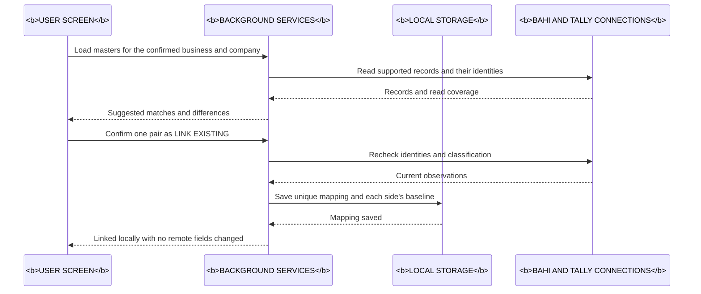
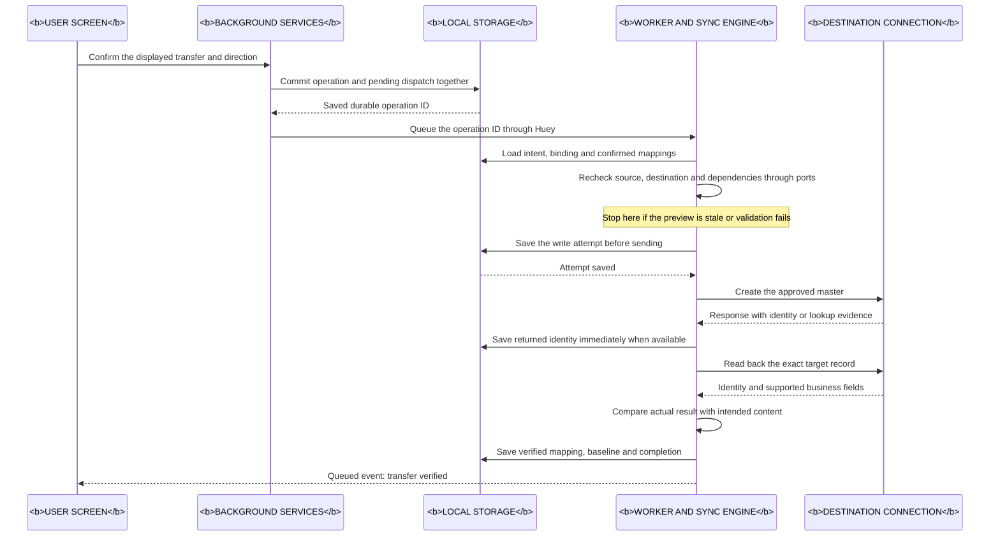
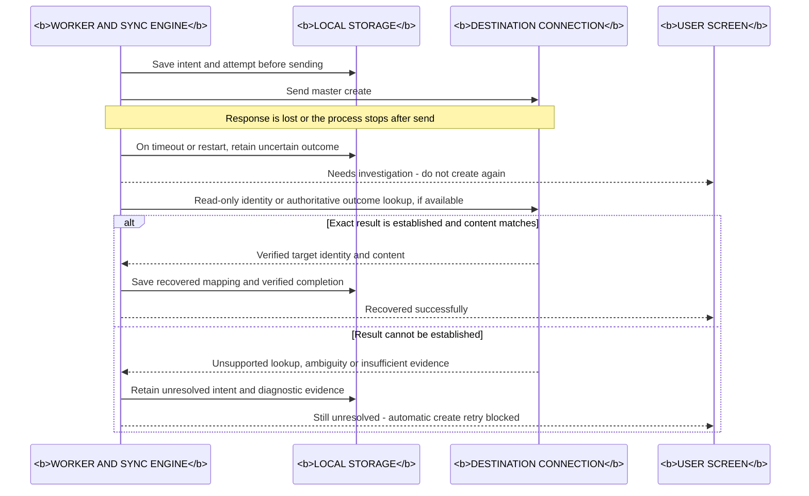

# Master sync sequence diagrams

Status: **PLANNED BEHAVIOR**, not executed master-sync code. Read each diagram
from top to bottom: a horizontal arrow is a message, and later messages appear
lower down. Component names are bold uppercase. These are logical interactions,
not proposed Python method signatures or additional threads.

## 1. Link two existing masters

**Example:** the user confirms that a Bahi supplier and a Tally supplier ledger
represent the same business. Linking saves a relationship locally; it does not
change either remote record.

The combined connection participant keeps the picture short. Actual Bahi and
Tally adapters are separate; all Tally reads use the shared serialized gateway.
Differences between linked records stay visible. Linking does not mark unequal
content as equal or authorize a later overwrite. Ambiguous matches require a
user decision, as specified in [matching rules](MASTER_MATCHING_RULES.md).

## 2. Transfer one master successfully

**Example:** create an approved customer in the selected destination. The
**DESTINATION CONNECTION** means Bahi's adapter for Tally-to-Bahi transfers, or
the shared Tally gateway for Bahi-to-Tally transfers. Source records have already
been loaded for preview; execution rechecks their freshness and dependencies.

**The important order is SAVE → SEND → READ BACK → VERIFY.** A response or import
counter alone is insufficient. Missing identity or mismatched content follows
investigation/conflict handling rather than the success path shown here.

The UI confirmation reaches background services through its bridge/controllers;
the screen does not access Huey directly. The worker uses application ports,
not concrete adapter imports. Metadata and Huey's queue are separate databases:
pending dispatch is recorded with the operation, then queued separately. Startup
recovery can redispatch a missed operation ID without creating another intent.
Database transactions end before HTTP. The source and destination may still be
edited concurrently; preflight reads do not replace conditional-write contracts.

For an allowed update, the same sequence uses the already mapped target identity
and only approved fields. The expected-version/content checks must still pass.
There is no invoice creation, posting or stock-balance write in this workflow.

## 3. A request may have succeeded, but the response is lost

**Example:** the connection times out after sending a master create. The
destination may already contain the master. The connector must investigate
before sending another create request.

An absent name-search result is not proof that the first create failed. When
available evidence proves a different result, show the mismatch/conflict rather
than claiming recovery succeeded. Bahi party creation currently lacks verified
idempotency/outcome lookup; the diagram does not introduce a new deployed API.
Known returned IDs permit targeted reads, but an unknown result may remain
unresolved. Retrying a create requires authoritative evidence that replay is safe.

See [operation states](MASTER_SYNC_STATES.md),
[design](MASTER_SYNC_DESIGN.md) and
[failure experiments](MASTER_SYNC_VALIDATION.md#failure-and-recovery-matrix).
