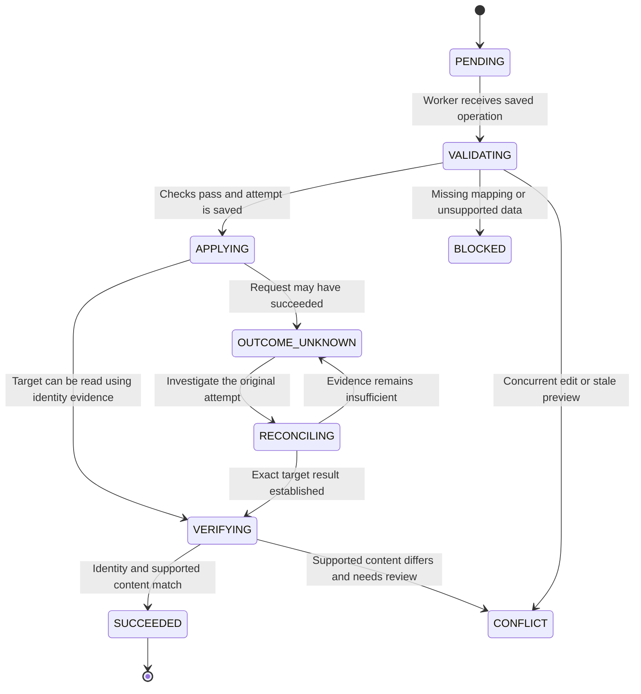

# Master sync operation states

Status: **PLANNED SHARED LIFECYCLE**, not an implemented master-specific state
machine. This is a readable view of the
[specification's operation lifecycle](../PROJECT_SPECIFICATION.md#operation-lifecycle).
The specification owns the rules; implemented definitions will belong in source.

## The normal path and uncertain writes

Read arrows as conditions for changing status. Bold uppercase labels name states.
The straight path is the normal successful transfer. The side path handles a
write whose result is uncertain.

This diagram deliberately shows the main path and investigation path. It is not
a complete transition implementation. Dependency failures and other exceptions
can arise at later checks too. Attention states retain history; they do not mean
the connector should discard the operation or issue another create.

## What the labels mean

| Label | Meaning for the user | What must happen next |
| --- | --- | --- |
| **PENDING** | Work is saved and waiting | Execute the same durable operation ID |
| **VALIDATING** | Checking the selected records and mappings | Verify binding, required fields, dependencies and freshness |
| **APPLYING** | A saved external attempt is being carried out | Send through the selected connection; retain returned identity |
| **VERIFYING** | Checking what actually exists at the destination | Compare identity and supported content by read-back |
| **SUCCEEDED** | This operation's intended effect was verified | Save the acknowledged baseline; later genuine edits can create new operations |
| **BLOCKED** | Required information or capability is missing | Resolve the cause, repreview if needed and revalidate; no blind replay |
| **CONFLICT** | Current records differ from the approved assumptions | Inspect baseline/source/destination and explicitly resolve with fresh checks |
| **OUTCOME_UNKNOWN** | The write may have happened | Investigate the original attempt before any retry |
| **RECONCILING** | Checking evidence for the uncertain write | Establish the actual result or keep it unresolved |

**LINK EXISTING** is a local mapping action with its own validation and audit;
it does not run a remote create through APPLYING. **SKIP** is a selection decision,
not a successful synchronization state. The table describes operation progress,
not whether the entire business is synchronized.

## Other shared lifecycle states

These exceptional or backend-dependent paths are separated to keep the main
diagram small. They use the same shared engine, not another queue or retry loop.

| State | When it applies | Safety rule |
| --- | --- | --- |
| **RETRY_WAIT** | A transient failure has a verified safe retry policy | Wait for bounded backoff, then return to PENDING; a timeout alone does not establish safe write replay |
| **FAILED** | A definitive failure or exhausted applicable policy needs intervention | Retain history and show the reason; never relabel an uncertain write as a safe fresh create |
| **ACK_PENDING** | Target effect is verified, but an agreed backend acknowledgment remains | Retry only acknowledgment, then SUCCEEDED; never recreate the target master |

The backend acknowledgment contract is proposed, not deployed/verified. The
initial supervised workflow does not invent an acknowledgment endpoint. A
read-back failure after sending a write must retain the saved target identity
and unfinished verification; it must not restart master creation.

## Simple example

A supplier create times out. Its status becomes **OUTCOME_UNKNOWN**, even if the
screen has no success message. Reconciliation uses saved identity/outcome evidence.
If it establishes the exact supplier and matching content, verification can
complete. If it cannot establish the result, the operation stays unresolved.
Closing and reopening the application must not make the supplier eligible for an
unconditional second create.

See [the sequence diagrams](MASTER_SYNC_SEQUENCES.md) for who sends each message,
and [validation cases](MASTER_SYNC_VALIDATION.md) for the tests required to prove
these paths. These diagrams are design aids, not evidence that recovery passes.
