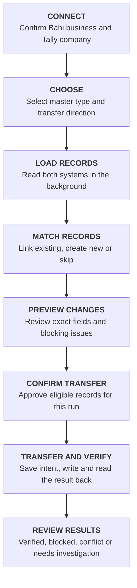

# Master sync UI flow

Status: planned native PySide6 workflow. No screens are implemented by this document.

## The user's path

Component titles are bold uppercase; arrows show the user's sequence, not direct
calls from widgets into adapters. Screen commands go through the UI bridge to
background services, with queued Qt progress events returning to the GUI.

## Screen contents

| Screen | Must show | User action |
| --- | --- | --- |
| **CONNECT** | Authenticated business and stable Tally company context; connection failures separately | Confirm the intended pair; enter key through secure local flow |
| **CHOOSE** | Customers, suppliers, groups or supported items; source and destination spelled out | Select one direction and review field ownership |
| **LOAD RECORDS** | Counts, page progress, freshness and incomplete/failed reads | Wait, cancel further reads or retry safe reads |
| **MATCH RECORDS** | Source record, candidates, classifications, unit/group differences and saved links | Link, create or skip per record |
| **PREVIEW CHANGES** | Existing value, proposed value, dependencies and missing required fields | Fill confirmed missing values or remove a record from the run |
| **CONFIRM TRANSFER** | Business/company, direction, create/update counts, skipped/blocked counts and stale-data warnings | Confirm only the displayed eligible work |
| **TRANSFER AND VERIFY** | Per-record progress, completed count and dependency waits | Pause scheduling of further work; do not claim an in-flight write was undone |
| **REVIEW RESULTS** | Verified identity, differences, actionable errors and unresolved attempts | Inspect, refresh/repreview or request eligible retry/reconciliation |

## Example preview

Synthetic example only; these are not actual business records or runnable payloads.

| Record | Action | Proposed change | Result before confirmation |
| --- | --- | --- | --- |
| Example Supplier | LINK EXISTING | Link two selected identities; no remote fields changed | Eligible |
| Example Customer | UPDATE LINKED | Phone: existing value -> user-reviewed new value | Eligible only after freshness/version checks |
| Example Goods Item | CREATE NEW | Name and description ready; unit missing | Blocked: confirm an existing unit mapping |
| Example Group | CREATE NEW | Name and mapped parent ready | Blocked until required Bahi tax/description fields are confirmed |

Never include blocked records in the success count. A skipped record is not
synchronized. A successful create response means verification is pending; only
matching identity/content read-back earns the user-facing verified result.

## Errors, interruptions and repeat actions

- **OFFLINE:** show which connection failed; combine repeated sync requests into
  bounded catch-up work. Keep previous results visible with their observation time.
- **NEEDS INPUT:** name the required field or mapping; offer return to preview.
- **CONFLICT:** show saved baseline, current Bahi value and current Tally value.
  Apply only a reviewed resolution supported by remote concurrency guarantees.
- **NEEDS INVESTIGATION:** explain that the request may have succeeded. Offer
  reconciliation/inspection, not a blind Create Again button.
- **PAUSE / QUIT:** stop scheduling new work, finish bounded requests or retain
  uncertain intent for recovery. Do not promise cancellation reverses a sent write.
- **SWITCH COMPANY:** pending operations retain their original binding; late UI
  responses from a previous selection cannot update the current screen.

Batch selection means several independently journaled operations, not one assumed
atomic bulk import. Show failures per record and allow unrelated work to proceed.
Keep credentials, raw XML, SQL, internal enums and stack traces out of user flows.
Use redacted diagnostics for support rather than presenting implementation detail.

See [matching rules](MASTER_MATCHING_RULES.md) and
[validation](MASTER_SYNC_VALIDATION.md) for the behavior each screen must preserve.
